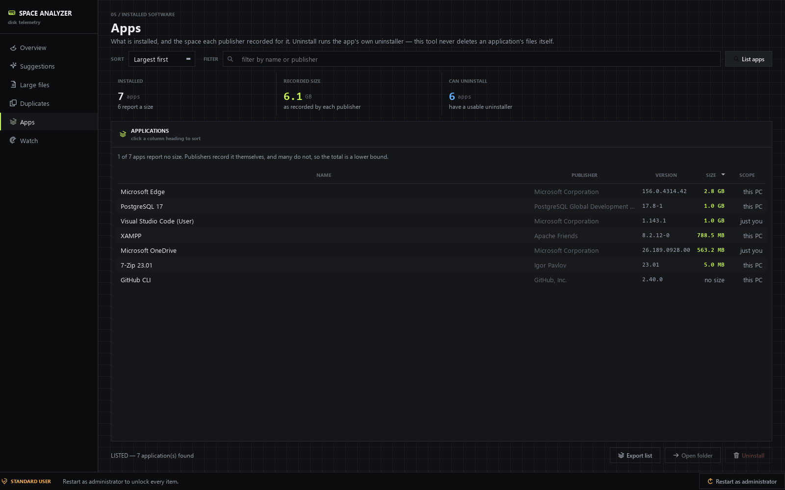
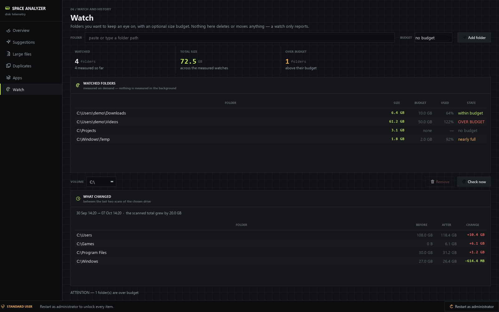

<div align="center">

# Windows Space Analyzer

**Find what fills your drives. Remove only what you choose. Lose nothing.**

A desktop tool for Windows 10 and 11 that shows where your disk space actually
went, then helps you get it back — with a safety gate in front of every deletion.

[](LICENSE)
[](https://www.python.org/downloads/)
[](https://pypi.org/project/PySide6/)
[](#requirements)
[](#running-the-tests)

[Quick start](#quick-start) ·
[What it does](#what-it-does) ·
[Safety](#why-you-can-trust-it-with-your-files) ·
[Docs](#documentation) ·
[Contributing](CONTRIBUTING.md)

</div>

---


## Why this exists

Windows tells you a drive is 91% full and stops there. The interesting questions
are *which folder*, *which file*, and *what can go* — and the answers are spread
across Settings, Explorer, `cleanmgr` and a handful of system commands that are
easy to get wrong.

This app answers them in one window, and then refuses to delete anything you did
not explicitly ask it to delete.

## What it does

| | Page | What it shows |
|---|---|---|
| `01` | **Overview** | Every fixed drive: a utilisation gauge, five readings, a read/unread/free breakdown, and the folder tree largest-first. |
| `02` | **Suggestions** | Sixteen cleanup candidates across seven categories, each with its size, risk level, what you lose, and whether it comes back. |
| `03` | **Large files** | The biggest files on a drive, filterable by size and name, sortable by any column. |
| `04` | **Duplicates** | Files with identical content, grouped, with one copy marked to keep. |
| `05` | **Apps** | Installed software, the size each publisher recorded, and its own uninstaller. |
| `06` | **Watch** | Folders you choose, an optional size budget, and what changed since the last scan. |

<details>
<summary><b>More screenshots</b></summary>

**Suggestions** — cleanup candidates grouped by category, with risk levels and
per-item consequences:


**Large files** — the biggest files, with a size filter and sortable columns:


**Duplicates** — identical content, grouped, with a guarantee that a group can
never lose every copy:


**Apps** — installed software with the size each publisher recorded, and a safe
uninstall that runs the app's own uninstaller:



**Watch** — folders with size budgets, and a change view showing what grew or
shrank between the last two scans of a drive:



</details>

### Beyond the original four pages

Three of these are new in 1.1.0, and one is an addition to an existing page.

**A file-type breakdown on Large files.** A stacked bar and a legend split the
listed files by kind — video, archive, installer and so on — so you can see
what is actually filling the drive rather than only which single file is biggest.
It is built from the largest-files list the scan already collected, so opening the
page costs nothing and never touches the disk.

**Apps.** Lists installed software from both the 32-bit and 64-bit uninstall keys,
with the size the publisher recorded. Many publishers record nothing, so the page
says how many are missing a size and calls the total a lower bound. Uninstall runs
the uninstaller the publisher registered, after showing you the exact command. The
app never deletes an application's files itself. A registered command is refused
unless it is an absolute local `.exe` path or an MsiExec product code — shells,
`del`, `format`, relative names and network shares are all blocked, and the status
line says why.

**Watch.** Folders you choose, each with an optional size budget. "Check now"
measures them and marks any that are over budget. Nothing is measured in the
background, and a watch never deletes or moves anything.

**Scan history and a change view.** Every finished scan is recorded so the Watch
page can show which folders grew, shrank, appeared or vanished since the previous
scan of the same drive. Only aggregate figures and the top-level folders are
stored — not your file names — and the history is capped at 60 entries.

**Export.** The file list, the app list, duplicate groups, cleanup suggestions and
cleanup reports can all be written as CSV or JSON. CSV output is guarded against
spreadsheet formula injection: a value starting with `=`, `+`, `-` or `@` is
prefixed with an apostrophe so a file named `=cmd|calc` cannot run when the report
is opened. CSV files also get a UTF-8 BOM, without which Excel renders non-ASCII
paths as mojibake.

### What it finds

Sixteen cleanup items, grouped by category. An item only appears if its target
actually exists on your machine.

| Category | Items |
|---|---|
| Temporary files | Your temporary files · Windows temporary files |
| Caches | Chrome · Edge · Firefox · Thumbnail and icon cache |
| Logs & crash dumps | Your crash dumps · System error reports · Windows log files · Memory dumps |
| Old Windows files | Windows Update download cache · Previous Windows installation |
| Recycle Bin | Recycle Bin |
| Hibernation & restore points | Hibernation file · System Restore points |
| System files | Page file *(information only — no action offered)* |

Full detail on each item, including what you lose, is in the
**[user guide](docs/USER_GUIDE.md#the-complete-cleanup-item-reference)**.

## Why you can trust it with your files

The design assumption is that a disk cleanup tool which overstates its own safety
is worse than one that admits its limits. So:

**One gate, in front of every deletion.** Every path the app removes passes
`safety.validate_target` first. It refuses drive roots, top-level folders, your
profile folder and the seven named folders under it, reparse points, anything
outside the item's declared roots, and protected system locations.

**The Recycle Bin by default.** Files go to the bin, not to oblivion, so a mistake
is recoverable. The app says plainly that space is not freed until the bin is
emptied.

**Permanent actions say so.** Emptying the bin, turning hibernation off, deleting
restore points and removing `Windows.old` each show a warning that the change
cannot be undone — and *No* is the default button.

**Administrator items are never pre-ticked.** Five items are ticked for you, all
`SAFE` and none needing elevation. Everything else waits for you.

**Links are never followed, and nothing is deleted recursively.** There is no
`shutil.rmtree`, no `os.remove`, no `os.rmdir` anywhere in the package.

**No telemetry, no network, no account.** Nothing leaves your machine. There is no
settings file.

The full model — including the honest list of known limitations — is in
**[docs/SAFETY.md](docs/SAFETY.md)**.

## Quick start

### Run the executable

Download `WindowsSpaceAnalyzer.exe` from the
[v1.0.1 release](https://github.com/akshaytp1571/windows-space-analyzer/releases/tag/v1.0.1)
and run it. No Python needed. It runs as a normal user and offers **Restart as
administrator** for the items that need it.

The binary is unsigned, so Windows SmartScreen will show a warning the first time
you run it. Click *More info* → *Run anyway*, or build it yourself from source
with `build_exe.bat` if you would rather not trust a downloaded binary — that is a
reasonable choice for a tool that deletes files.

| | |
|---|---|
| File | `WindowsSpaceAnalyzer.exe` |
| Version | 1.0.1 |
| Size | 51,525,221 bytes (49.1 MB) |
| SHA-256 | `add8e971198498f6497fcd2626e98d18fc205ea814545666f2b498b1d16bd475` |

Verify it after downloading:

```powershell
Get-FileHash .\WindowsSpaceAnalyzer.exe -Algorithm SHA256
```

### Run from source

```bat
git clone https://github.com/akshaytp1571/windows-space-analyzer.git
cd windows-space-analyzer
run_app.bat
```

`run_app.bat` creates `.venv` and installs the two dependencies on first run.

Or by hand:

```bat
py -3 -m venv .venv
.venv\Scripts\python.exe -m pip install -r requirements.txt
.venv\Scripts\python.exe main.py
```

### Build the single-file executable

```bat
build_exe.bat
```

Produces `dist\WindowsSpaceAnalyzer.exe` — one file, no Python required on the
target machine.

## Requirements

* Windows 10 or 11 (64-bit)
* Python 3.10 or newer, when running from source
* [PySide6](https://pypi.org/project/PySide6/) 6.x and
  [send2trash](https://pypi.org/project/send2trash/) 1.8+

The engine — scanner, analyzer, cleaner, duplicates — uses only the standard
library plus `send2trash`. It imports and tests on Linux, which is how CI checks
it. Only the interface needs a Windows desktop.

## Running the tests

```bat
run_tests.bat
```

or

```bat
.venv\Scripts\python.exe -m unittest discover -s tests -t .
```

433 tests. Engine tests use temporary directories and a fake recycler, so no real
file is ever touched. UI tests need PySide6 and run headless with
`QT_QPA_PLATFORM=offscreen`.

On Linux or in CI, also point Qt at a font directory, otherwise text renders as
empty boxes:

```bash
export QT_QPA_PLATFORM=offscreen
export QT_QPA_FONTDIR=/usr/share/fonts/truetype/dejavu
python -m unittest discover -s tests -t .
```

## Documentation

| Document | What is in it |
|---|---|
| **[User guide](docs/USER_GUIDE.md)** | How to use every page, and the complete reference for all sixteen cleanup items |
| **[Safety model](docs/SAFETY.md)** | Exactly what is refused, by which code, and the known limitations |
| **[Architecture](docs/ARCHITECTURE.md)** | The module contract: signatures, invariants and item definitions |
| **[Development](docs/DEVELOPMENT.md)** | Layout, conventions, threading, how to add a cleanup item |
| **[Contributing](CONTRIBUTING.md)** | Setup, the rules for a pull request, and the one non-negotiable |
| **[Security policy](SECURITY.md)** | How to report a safety or data-loss bug privately |
| **[Changelog](CHANGELOG.md)** | What changed, and when |

## Project layout

```
main.py                     launcher
space_analyzer/
    models.py               dataclasses and enums shared by everything
    util.py                 size, count and time formatting
    system.py               drives, admin rights, protected paths, command runner
    scanner.py              disk scanner and measure_path
    duplicates.py           duplicate file finder
    recycle.py              Recycle Bin send, empty and info
    safety.py               validate_target — the gate
    cleaner.py              delete_to_recycle and perform
    analyzer.py             build_suggestions
    rules.py                one function per cleanup item
    apps.py                 installed-app inventory and the uninstall launcher
    export.py               CSV and JSON writers, with formula-injection guards
    history.py              scan snapshots and the delta between two of them
    watches.py              watched folders, budgets and measurement
    ui/
        app.py              run() entry point
        state.py            shared Qt state
        workers.py          background worker thread
        theme.py            colours, fonts, stylesheet
        icons.py            sixteen vector icons painted in code
        widgets.py          gauge, segment bar, readouts, panels, page scroll
        breakdown.py        file-type grouping behind the Large files bar
        main_window.py      rail navigation and status bar
        dialogs.py          confirm(), show_reports() and ask_save_path()
        page_logic.py       pure rules behind the pages
        pages/              the six pages
tests/                      unittest suite, one file per module
docs/                       documentation
assets/                     screenshots used in this README
```

## Design notes

The interface is built around one idea: **this is a measurement instrument, not a
web dashboard.** That decision drives every visual choice.

- **Blueprint grid backdrop** on every page — a cached 24px tile, painted, no
  asset.
- **Square hairline panels**, not rounded cards with drop shadows.
- **Monospace numerals** for every measured value; labels stay in the UI font.
  This is what makes numbers read as readings rather than text.
- **One accent colour**, acid lime `#c8f751`. Risk levels get amber, blue and red.
  Nothing else is coloured.
- **Numbered page eyebrows** (`01 / drive telemetry`) and **status verbs in caps**
  (`IDLE`, `SCANNING`, `COMPLETE`, `FAILED`).
- **Icons painted with `QPainter`** on a 24-unit grid, so there are no image
  assets and no icon-theme dependency.

## Known limitations

Listed here rather than buried, because a tool that deletes files should be
honest about what it does not do.

- **No export.** The figures cannot be saved to CSV or JSON yet.
- **Fixed drives only.** Removable and network drives are excluded on purpose,
  because the cleanup rules assume Windows-managed locations.
- **Windows 10/11 only.** Older versions lack the commands and APIs used.
- **No undo of its own.** Recovery relies on the Recycle Bin, which is why the bin
  is the default destination.
- **Duplicate search reads every candidate file**, so it is I/O-bound on a large
  drive and can take several minutes.
- Safety-model gaps are enumerated in
  [docs/SAFETY.md](docs/SAFETY.md#where-the-never-widen-promise-holds-and-where-it-does-not).

## Contributing

Contributions are welcome — issues, fixes, new cleanup rules, documentation.
Start with **[CONTRIBUTING.md](CONTRIBUTING.md)**.

The one rule that is not negotiable: **nothing may delete, move, or modify a file
without passing `safety.validate_target` first**, or being one of the documented
exceptions. Pull requests that bypass the gate are rejected regardless of how
useful they are.

Found a safety bug? Please report it privately per **[SECURITY.md](SECURITY.md)**
rather than opening a public issue.

## License

[MIT](LICENSE) © 2026 Windows Space Analyzer contributors.

This software deletes files. It is provided as a convenience, not a data-recovery
tool. Keep independent backups of anything you cannot afford to lose. The full
disclaimer is in the [LICENSE](LICENSE) file — please read it.
