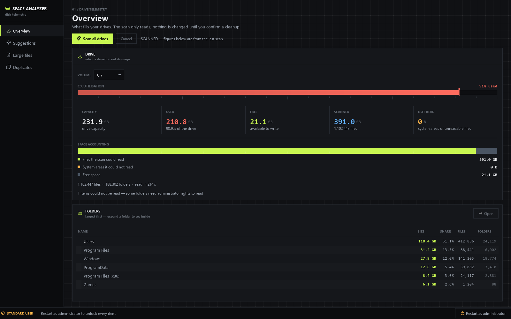
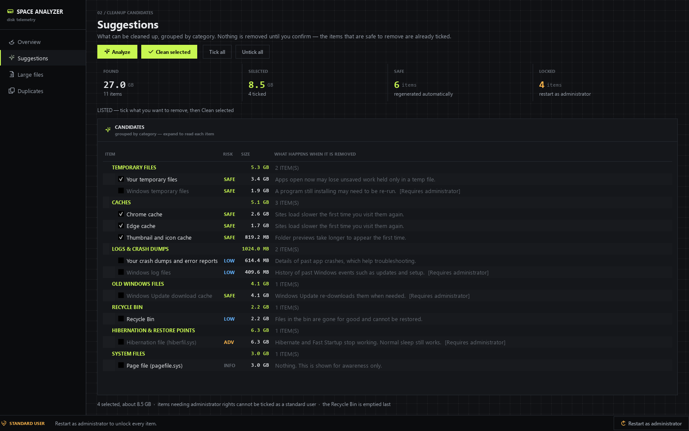
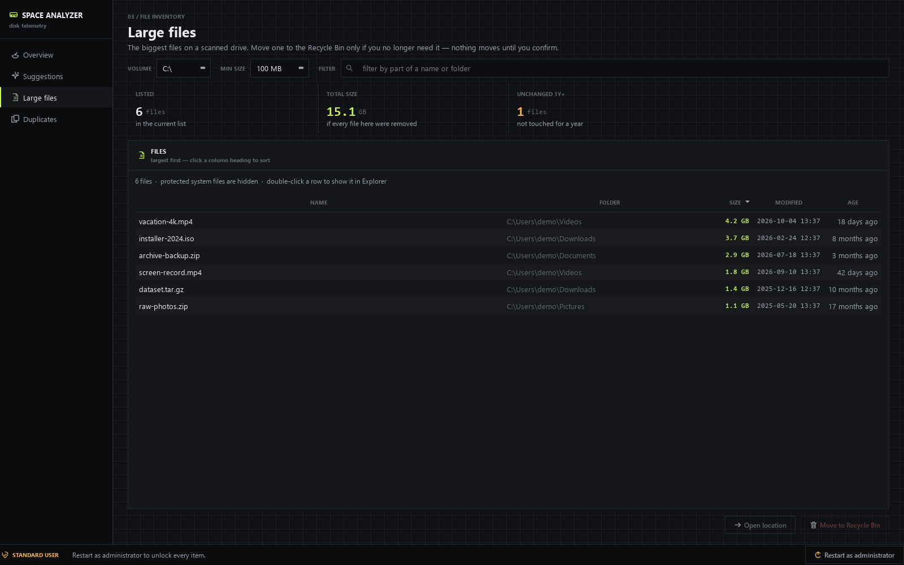
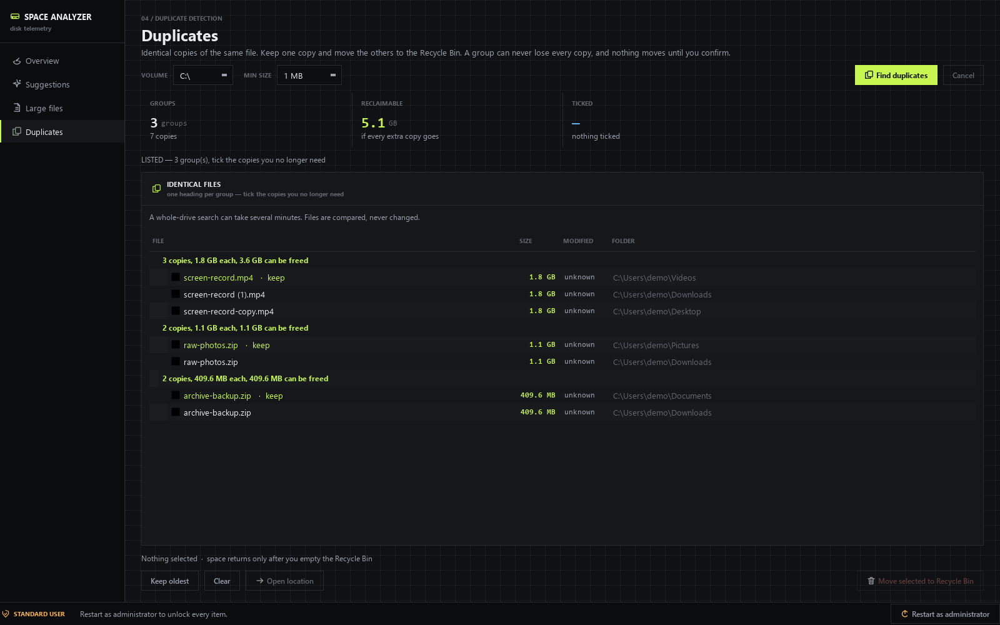

# User guide

Windows Space Analyzer finds what fills your drives and helps you remove what you
do not need. Nothing is deleted until you confirm it, and files you select go to
the Recycle Bin by default.

## Getting started

Run `run_app.bat`, or `python main.py` from an activated environment. The window
opens on **Overview** with your drives listed.

The first thing to do is click **Scan all drives**. A full scan of a large drive
takes a few minutes; the status line shows the folder it is reading and you can
cancel at any time. Cancelling keeps the partial figures and labels them as
partial.

The bottom-left badge tells you whether the app is running as a standard user or
as an administrator. Administrator rights unlock a few extra cleanup items; the
app never asks for them on its own. If you want them, use **Restart as
administrator** in the bottom-right corner.

## The four pages

### Overview — what is using the space

Shows every fixed drive with a utilisation gauge, five readings, and a breakdown
of the drive into read files, unread system areas, and free space.

The five readings:

| Reading | Meaning |
|---|---|
| **Capacity** | The size of the drive |
| **Used** | Bytes in use, and what percentage of the drive that is |
| **Free** | Bytes available to write |
| **Scanned** | Bytes the scan could actually read, and how many files that was |
| **Not read** | System areas or files the scan was refused access to |

*Not read* is not a failure of the app — Windows protects some locations from any
program. It is shown separately so the numbers always add up honestly.

Below that is the folder tree, largest first. Expand any folder to see inside.
Double-click a folder, or use **Open**, to show it in Explorer.

### Suggestions — what can be cleaned up

Click **Analyze** to measure every cleanup candidate on this PC. Items are
grouped by category, and each row shows its size, its risk level, and what
happens if you remove it.

Four readings summarise the list:

| Reading | Meaning |
|---|---|
| **Found** | Total size of every candidate found |
| **Selected** | Total size of what you have ticked |
| **Safe** | How many items are automatically regenerated |
| **Locked** | How many items need administrator rights |

Items whose risk is `SAFE` are ticked for you. Everything else waits for you to
tick it. Items needing administrator rights can never be ticked by a standard
user.

When you are ready, click **Clean selected**. A dialog lists exactly what will be
removed, its total size, and any warnings. Nothing happens until you accept.

> **Space is not freed until the Recycle Bin is emptied.** Files go to the bin,
> not to oblivion, so you can restore a mistake. The app offers to empty the bin
> once the cleanup is done.

### Large files — the biggest files on a drive

Every file above the size filter, largest first. Use the filter box to narrow by
part of a name or folder. Click a column heading to sort.

Select one or more rows and use **Move to Recycle Bin**, or **Open location** to
show the file in Explorer. Double-clicking a row opens its folder.

Files inside `AppData` carry a warning: some applications keep their data there,
and removing it can reset that application.

### Duplicates — identical files

Click **Find duplicates** to hash the files on a drive. Files with identical
content are grouped together. Each group shows how many copies exist, the size of
each, and how much you would free by keeping one.

**A group can never lose every copy.** The app refuses to tick the last unticked
copy in a group, and says so if you try. The oldest file in each group is marked
`keep`.

Select the copies you no longer need and use **Move selected to Recycle Bin**.
Use **Keep oldest** to tick everything except the oldest copy in each group, and
**Clear** to untick everything.

A whole-drive duplicate search reads every candidate file, so it can take several
minutes on a large drive.

## The complete cleanup item reference

Sixteen items exist. An item only appears in the list if its target actually
exists on your PC, so you will normally see fewer than sixteen.

**Risk levels:** `SAFE` is regenerated automatically with no meaningful loss.
`LOW` is harmless but may cost time or convenience later. `ADVANCED` is a
system-level change with a real trade-off. `INFO` is awareness only — no action is
offered.

### Temporary files

| Item | Risk | Pre-ticked | Admin | Comes back |
|---|---|---|---|---|
| Your temporary files | `SAFE` | Yes | No | Yes, new ones are created as needed |
| Windows temporary files | `SAFE` | No | **Yes** | Yes, new ones are created as needed |

*Your temporary files* is the folder your apps write scratch data into. Removing
it while an app is running could lose unsaved work that exists only in a temp
file, so close what you are working on first.

*Windows temporary files* holds leftovers from Windows setup and installers. A
program that is installing right now may need to be run again.

### Caches

| Item | Risk | Pre-ticked | Admin | Comes back |
|---|---|---|---|---|
| Chrome cache | `SAFE` | Yes | No | Yes, rebuilt automatically |
| Edge cache | `SAFE` | Yes | No | Yes, rebuilt automatically |
| Firefox cache | `SAFE` | Yes | No | Yes, rebuilt automatically |
| Thumbnail and icon cache | `SAFE` | Yes | No | Yes, rebuilt automatically |

Browser caches hold copies of web pages and images so sites load faster. Removing
one means sites are slower the first time you visit them again. Your passwords,
bookmarks, history and saved logins are **not** affected — those live elsewhere.

**Close the browser first.** If it is still running, Windows may let only part of
the cache be removed.

The thumbnail cache holds the small previews Explorer shows for folders and
images. Removing it makes those previews take longer to appear the first time.

### Logs and crash dumps

| Item | Risk | Pre-ticked | Admin | Comes back |
|---|---|---|---|---|
| Your crash dumps and error reports | `LOW` | No | No | Yes, new ones are created as needed |
| System error reports | `LOW` | No | **Yes** | Yes, new ones are created as needed |
| Windows log files | `LOW` | No | **Yes** | Yes, new ones are created as needed |
| Memory dump and minidumps | `LOW` | No | **Yes** | Yes, new ones are created as needed |

These are records of past crashes and Windows events. They are only useful if you
are troubleshooting a problem — if you are, keep them. If you are not, they are
dead weight.

A *memory dump* is what a blue screen writes. It can be as large as your RAM.

### Old Windows files

| Item | Risk | Pre-ticked | Admin | Comes back |
|---|---|---|---|---|
| Windows Update download cache | `SAFE` | No | **Yes** | Yes, Windows Update downloads them again |
| Previous Windows installation | `ADVANCED` | No | **Yes** | **No** |

*Windows Update download cache* holds update packages Windows has already
installed. Removing them means a future update re-downloads data, using more
internet. This item goes to the Recycle Bin, so **the space is not freed until you
empty the bin**. Windows Update is paused for the few seconds the move takes.

*Previous Windows installation* (`Windows.old`) is the old copy of Windows kept so
you can roll back after an upgrade. **Removing it means you can no longer go back.**
Windows deletes it permanently with its own tool — it does not go to the Recycle
Bin. Windows normally removes it by itself about ten days after an upgrade.

### Recycle Bin

| Item | Risk | Pre-ticked | Admin | Comes back |
|---|---|---|---|---|
| Recycle Bin | `LOW` | No | No | **No** |

Empties the bin. **Everything in it is gone for good**, including files you put
there yourself outside this app. This is the only way to actually turn the space
the other items freed into usable free space.

### Hibernation and restore points

| Item | Risk | Pre-ticked | Admin | Comes back |
|---|---|---|---|---|
| Hibernation file (`hiberfil.sys`) | `ADVANCED` | No | **Yes** | Yes, when hibernation is turned back on |
| System Restore points | `ADVANCED` | No | **Yes** | **No** |

*Hibernation file* is a copy of your RAM that Windows writes when it hibernates,
so it is roughly the size of your memory. Removing it turns hibernation **and Fast
Startup** off. Normal sleep still works. Windows deletes the file itself, so it
does not go to the Recycle Bin. You can turn hibernation back on later with
`powercfg /hibernate on`.

*System Restore points* let you roll Windows back to an earlier state. This action
removes the older ones and **keeps the newest**, so you retain one recovery point.
They are removed permanently. Shadow copies made by backup software on the same
drive may also be removed.

### System files

| Item | Risk | Pre-ticked | Admin | Comes back |
|---|---|---|---|---|
| Page file (`pagefile.sys`) | `INFO` | — | No | Recreated automatically |

Shown for awareness only. Windows uses the page file as extra memory, and it is
managed by Windows. **There is no action offered and nothing to tick.** It is
listed so you can see what is using the space.

## Recovering something you removed

If you used a normal cleanup, the files are in the Recycle Bin. Open it from your
desktop and restore them.

If you emptied the bin, or used one of the permanent actions (hibernation file,
restore points, `Windows.old`, or emptying the bin itself), the change cannot be
undone by this app. That is why each of those is confirmed with a warning first.

## Frequently asked questions

**Why did my free space not increase?**
Because the files went to the Recycle Bin. Empty it — the Suggestions page offers
to do this once a cleanup finishes.

**Is it safe to remove everything marked SAFE?**
Those items are regenerated automatically. The one to be careful with is *Your
temporary files*: close your apps first, because a running program may keep
unsaved work in a temp file.

**Why can I not tick some items?**
They need administrator rights. Use **Restart as administrator**.

**Why is "Not read" so large?**
Windows protects system folders from every program. The scan reports what it
could not read rather than pretending the drive is smaller. Running as
administrator usually reduces this figure.

**Does this work on Windows 7 or 8?**
No. Windows 10 and 11 are supported. The app relies on commands and APIs that are
not all present on older versions.

**Can I use it on a network drive or USB stick?**
Only fixed drives are scanned. Removable and network drives are excluded on
purpose, because cleanup rules assume Windows-managed locations.

**Where does it store my data?**
Nowhere. There is no settings file, no telemetry, no network access, and no
account. Closing the app forgets everything it learned.

**Can I get the numbers as a file?**
Not currently. This is a known gap; see the open issues.

## Keyboard and mouse

| Action | How |
|---|---|
| Switch page | Click the left rail, or focus it and use the arrow keys |
| Sort a table | Click a column heading |
| Open a file's folder | Double-click the row, or use **Open location** |
| Expand a folder | Click the arrow, or double-click the row |
| Close a dialog | `Esc` cancels |
